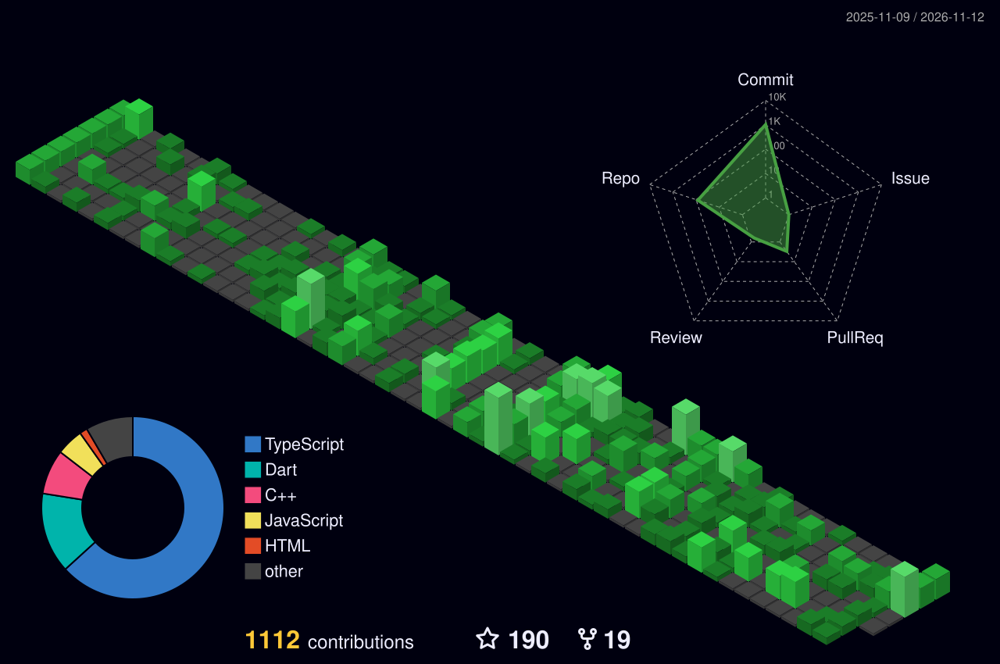
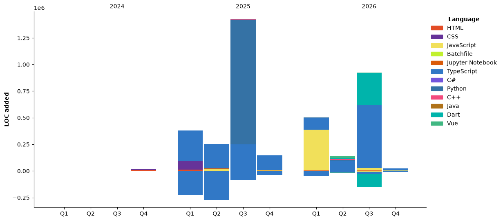

<h1 align="center">
  
</h1>

<div align="center">
  <a href="https://krajtilak.in" title="Portfolio"></a>
  <a href="https://www.linkedin.com/in/krajtilak2020" title="LinkedIn"></a>
  <a href="https://x.com/2020rajtilak" title="X (Twitter)"></a>
  <a href="https://instagram.com/k.rajtilak2020" title="Instagram"></a>
</div>

## 👨🏻‍💻 About Me


```javascript
const krajtilak = {
    Education: "BTech CSE - Cyber Defence",
    Passion: ["Web Development", "Cyber-Security", "IoT"],
    Website: "krajtilak.in",
};
```
<p align="left">
  A passionate <b>Cyber Security</b> student, I strive to bridge the gap between innovative ideas and transformative technologies. My expertise includes <b>Web Development</b>, <b>Cyber Security</b>, <b>IoT</b>, and <b>Collaborative GitHub Projects</b>.
</p>

## 🛠️ Technologies & Tools
<div align="center">
  
</div>

## 📊 GitHub Statistics



## ⌨️ My Coding Stats

<!--START_SECTION:waka-->


**🐱 My GitHub Data** 

> 📦 4.8 MB Used in GitHub's Storage 
 > 
> 🏆 966 Contributions in the Year 2026
 > 
> 💼 Opted to Hire
 > 
> 📜 151 Public Repositories 
 > 
> 🔑 32 Private Repositories 
 > 
**I'm an Early 🐤** 

```text
🌞 Morning                685 commits         █████░░░░░░░░░░░░░░░░░░░░   18.31 % 
🌆 Daytime                1301 commits        █████████░░░░░░░░░░░░░░░░   34.78 % 
🌃 Evening                1218 commits        ████████░░░░░░░░░░░░░░░░░   32.56 % 
🌙 Night                  537 commits         ████░░░░░░░░░░░░░░░░░░░░░   14.35 % 
```
📅 **I'm Most Productive on Friday** 

```text
Monday                   520 commits         ███░░░░░░░░░░░░░░░░░░░░░░   13.90 % 
Tuesday                  469 commits         ███░░░░░░░░░░░░░░░░░░░░░░   12.54 % 
Wednesday                438 commits         ███░░░░░░░░░░░░░░░░░░░░░░   11.71 % 
Thursday                 506 commits         ███░░░░░░░░░░░░░░░░░░░░░░   13.53 % 
Friday                   677 commits         █████░░░░░░░░░░░░░░░░░░░░   18.10 % 
Saturday                 484 commits         ███░░░░░░░░░░░░░░░░░░░░░░   12.94 % 
Sunday                   647 commits         ████░░░░░░░░░░░░░░░░░░░░░   17.29 % 
```


📊 **This Week I Spent My Time On** 

```text
🕑︎ Time Zone: Asia/Kolkata

💬 Programming Languages: 
TypeScript               6 hrs 20 mins       ████████████████░░░░░░░░░   64.09 % 
Other                    1 hr 47 mins        █████░░░░░░░░░░░░░░░░░░░░   18.14 % 
JSON                     39 mins             ██░░░░░░░░░░░░░░░░░░░░░░░   06.64 % 
Markdown                 39 mins             ██░░░░░░░░░░░░░░░░░░░░░░░   06.62 % 
Docker                   8 mins              ░░░░░░░░░░░░░░░░░░░░░░░░░   01.45 % 

🔥 Editors: 
VS Code                  8 hrs 16 mins       █████████████████████░░░░   83.64 % 
Antigravity CLI          1 hr 24 mins        ████░░░░░░░░░░░░░░░░░░░░░   14.23 % 
Copilot CLI              12 mins             █░░░░░░░░░░░░░░░░░░░░░░░░   02.12 % 

🐱‍💻 Projects: 
Darpan                   7 hrs 9 mins        ██████████████████░░░░░░░   72.34 % 
GreenAI-2027             1 hr 46 mins        ████░░░░░░░░░░░░░░░░░░░░░   17.99 % 
krajtilak                52 mins             ██░░░░░░░░░░░░░░░░░░░░░░░   08.88 % 
K Rajtilak               4 mins              ░░░░░░░░░░░░░░░░░░░░░░░░░   00.79 % 

💻 Operating System: 
Windows                  6 hrs 50 mins       █████████████████░░░░░░░░   69.14 % 
Linux                    3 hrs 3 mins        ████████░░░░░░░░░░░░░░░░░   30.86 % 
```

🤖 **AI Coding This Week** 

```text
⏱ AI Coding Time: 9 hrs 1 min (91.23%)

✍️ 0 lines written by AI, 102 lines written by hand (0.0% AI-written)

🔤 412,290 Input Tokens, 11,192 Output Tokens

💵 $0.91 Estimated AI Cost This Week

🧠 13 AI Sessions, 200 AI Prompts

Gemini                   0 lines             ░░░░░░░░░░░░░░░░░░░░░░░░░   00.00 % 
GPT                      0 lines             ░░░░░░░░░░░░░░░░░░░░░░░░░   00.00 % 

🔎 AI Coding Insights:
🧑‍💻 Mostly Hands-On — 0.0% of written lines came from AI
📝 Concise Prompter — average 256 characters per prompt
🔁 Iterative Prompter — average 15 prompts per session
🔍 Hands-On Reviewer — 100.0% of changed lines were hand-edited
```

**I Mostly Code in TypeScript** 

```text
TypeScript               40 repos            █████████░░░░░░░░░░░░░░░░   35.09 % 
JavaScript               17 repos            ████░░░░░░░░░░░░░░░░░░░░░   14.91 % 
HTML                     11 repos            ██░░░░░░░░░░░░░░░░░░░░░░░   09.65 % 
Vue                      4 repos             █░░░░░░░░░░░░░░░░░░░░░░░░   03.51 % 
Dart                     2 repos             ░░░░░░░░░░░░░░░░░░░░░░░░░   01.75 % 
```


**Timeline**




 Last Updated on 08/11/2026 22:21:59 UTC
<!--END_SECTION:waka-->


## ✍️ Random Dev Quote
<div align="center">
  
</div>

---

<p align="right">
  
</p>
