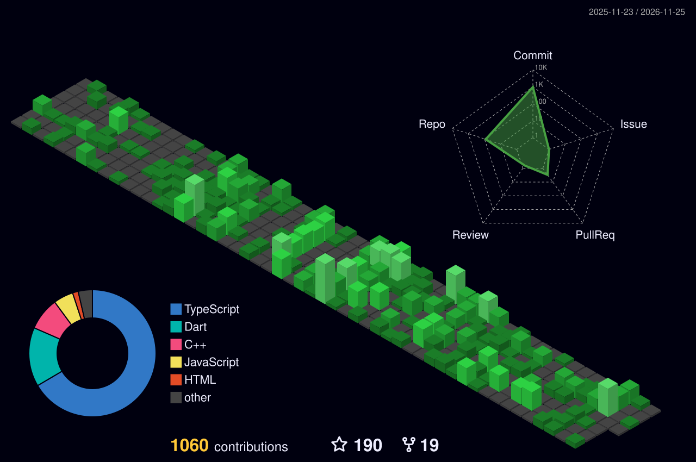
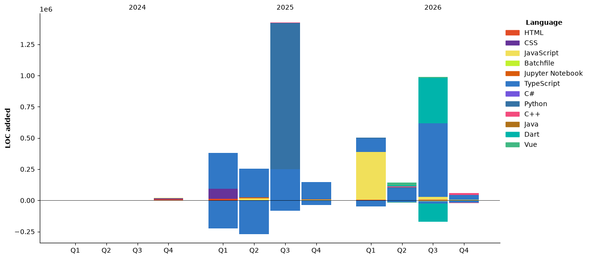

<h1 align="center">
  
</h1>

<div align="center">
  <a href="https://krajtilak.in" title="Portfolio"></a>
  <a href="https://www.linkedin.com/in/krajtilak2020" title="LinkedIn"></a>
  <a href="https://x.com/2020rajtilak" title="X (Twitter)"></a>
  <a href="https://instagram.com/k.rajtilak2020" title="Instagram"></a>
</div>

## 👨🏻‍💻 About Me


```javascript
const krajtilak = {
    Education: "BTech CSE - Cyber Defence",
    Passion: ["Web Development", "Cyber-Security", "IoT"],
    Website: "krajtilak.in",
};
```
<p align="left">
  A passionate <b>Cyber Security</b> student, I strive to bridge the gap between innovative ideas and transformative technologies. My expertise includes <b>Web Development</b>, <b>Cyber Security</b>, <b>IoT</b>, and <b>Collaborative GitHub Projects</b>.
</p>

## 🛠️ Technologies & Tools
<div align="center">
  
</div>

## 📊 GitHub Statistics



## ⌨️ My Coding Stats

<!--START_SECTION:waka-->


**🐱 My GitHub Data** 

> 📦 4.9 MB Used in GitHub's Storage 
 > 
> 🏆 1,002 Contributions in the Year 2026
 > 
> 💼 Opted to Hire
 > 
> 📜 151 Public Repositories 
 > 
> 🔑 33 Private Repositories 
 > 
**I'm an Early 🐤** 

```text
🌞 Morning                705 commits         ████░░░░░░░░░░░░░░░░░░░░░   17.97 % 
🌆 Daytime                1349 commits        █████████░░░░░░░░░░░░░░░░   34.39 % 
🌃 Evening                1305 commits        ████████░░░░░░░░░░░░░░░░░   33.27 % 
🌙 Night                  564 commits         ████░░░░░░░░░░░░░░░░░░░░░   14.38 % 
```
📅 **I'm Most Productive on Sunday** 

```text
Monday                   547 commits         ███░░░░░░░░░░░░░░░░░░░░░░   13.94 % 
Tuesday                  510 commits         ███░░░░░░░░░░░░░░░░░░░░░░   13.00 % 
Wednesday                439 commits         ███░░░░░░░░░░░░░░░░░░░░░░   11.19 % 
Thursday                 529 commits         ███░░░░░░░░░░░░░░░░░░░░░░   13.48 % 
Friday                   700 commits         ████░░░░░░░░░░░░░░░░░░░░░   17.84 % 
Saturday                 496 commits         ███░░░░░░░░░░░░░░░░░░░░░░   12.64 % 
Sunday                   702 commits         ████░░░░░░░░░░░░░░░░░░░░░   17.89 % 
```


📊 **This Week I Spent My Time On** 

```text
🕑︎ Time Zone: Asia/Kolkata

💬 Programming Languages: 
C++                      4 hrs 22 mins       █████████████░░░░░░░░░░░░   51.63 % 
JSON                     2 hrs 21 mins       ███████░░░░░░░░░░░░░░░░░░   27.76 % 
TypeScript               40 mins             ██░░░░░░░░░░░░░░░░░░░░░░░   07.95 % 
Text                     31 mins             ██░░░░░░░░░░░░░░░░░░░░░░░   06.22 % 
Other                    12 mins             █░░░░░░░░░░░░░░░░░░░░░░░░   02.48 % 

🔥 Editors: 
VS Code                  7 hrs 45 mins       ███████████████████████░░   91.68 % 
Antigravity CLI          42 mins             ██░░░░░░░░░░░░░░░░░░░░░░░   08.32 % 

🐱‍💻 Projects: 
PulseOTA v2              7 hrs 34 mins       ██████████████████████░░░   89.34 % 
Darpan                   30 mins             ██░░░░░░░░░░░░░░░░░░░░░░░   06.04 % 
K Rajtilak               9 mins              ░░░░░░░░░░░░░░░░░░░░░░░░░   01.86 % 
PulseOTA                 9 mins              ░░░░░░░░░░░░░░░░░░░░░░░░░   01.85 % 
GreenAI-2027             4 mins              ░░░░░░░░░░░░░░░░░░░░░░░░░   00.91 % 

💻 Operating System: 
Windows                  8 hrs 28 mins       █████████████████████████   100.00 % 
```

🤖 **AI Coding This Week** 

```text
⏱ AI Coding Time: 6 hrs 32 mins (77.3%)

✍️ 0 lines written by AI, 2 lines written by hand (0.0% AI-written)

🔤 275,082 Input Tokens, 9,878 Output Tokens

💵 $0.67 Estimated AI Cost This Week

🧠 4 AI Sessions, 136 AI Prompts

Gemini                   0 lines             ░░░░░░░░░░░░░░░░░░░░░░░░░   00.00 % 

🔎 AI Coding Insights:
🧑‍💻 Mostly Hands-On — 0.0% of written lines came from AI
📄 Detailed Prompter — average 899 characters per prompt
🔁 Iterative Prompter — average 34 prompts per session
🔍 Hands-On Reviewer — 100.0% of changed lines were hand-edited
```

**I Mostly Code in TypeScript** 

```text
TypeScript               40 repos            █████████░░░░░░░░░░░░░░░░   34.78 % 
JavaScript               17 repos            ████░░░░░░░░░░░░░░░░░░░░░   14.78 % 
C++                      12 repos            ███░░░░░░░░░░░░░░░░░░░░░░   10.43 % 
HTML                     11 repos            ██░░░░░░░░░░░░░░░░░░░░░░░   09.57 % 
Vue                      4 repos             █░░░░░░░░░░░░░░░░░░░░░░░░   03.48 % 
```


**Timeline**




 Last Updated on 15/11/2026 23:06:12 UTC
<!--END_SECTION:waka-->


## ✍️ Random Dev Quote
<div align="center">
  
</div>

---

<p align="right">
  
</p>
