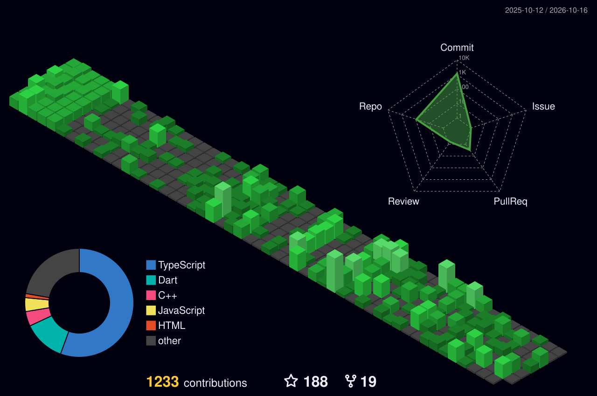

<h1 align="center">
  
</h1>

<div align="center">
  <a href="https://krajtilak.in" title="Portfolio"></a>
  <a href="https://www.linkedin.com/in/krajtilak2020" title="LinkedIn"></a>
  <a href="https://x.com/2020rajtilak" title="X (Twitter)"></a>
  <a href="https://instagram.com/k.raj_tilak2020" title="Instagram"></a>
</div>

## 👨🏻‍💻 About Me


```javascript
const krajtilak = {
    Education: "BTech CSE - Cyber Defence",
    Passion: ["Web Development", "Cyber-Security", "IoT"],
    Website: "krajtilak.in",
};
```
<p align="left">
  A passionate <b>Cyber Security</b> student, I strive to bridge the gap between innovative ideas and transformative technologies. My expertise includes <b>Web Development</b>, <b>Cyber Security</b>, <b>IoT</b>, and <b>Collaborative GitHub Projects</b>.
</p>

## 🛠️ Technologies & Tools
<div align="center">
  
</div>

## 📊 GitHub Statistics



## ⌨️ My Coding Stats

<!--START_SECTION:waka-->


**🐱 My GitHub Data** 

> 📦 4.8 MB Used in GitHub's Storage 
 > 
> 🏆 935 Contributions in the Year 2026
 > 
> 💼 Opted to Hire
 > 
> 📜 151 Public Repositories 
 > 
> 🔑 31 Private Repositories 
 > 
**I'm an Early 🐤** 

```text
🌞 Morning                663 commits         █████░░░░░░░░░░░░░░░░░░░░   18.60 % 
🌆 Daytime                1237 commits        █████████░░░░░░░░░░░░░░░░   34.71 % 
🌃 Evening                1140 commits        ████████░░░░░░░░░░░░░░░░░   31.99 % 
🌙 Night                  524 commits         ████░░░░░░░░░░░░░░░░░░░░░   14.70 % 
```
📅 **I'm Most Productive on Friday** 

```text
Monday                   505 commits         ████░░░░░░░░░░░░░░░░░░░░░   14.17 % 
Tuesday                  446 commits         ███░░░░░░░░░░░░░░░░░░░░░░   12.51 % 
Wednesday                436 commits         ███░░░░░░░░░░░░░░░░░░░░░░   12.23 % 
Thursday                 480 commits         ███░░░░░░░░░░░░░░░░░░░░░░   13.47 % 
Friday                   650 commits         █████░░░░░░░░░░░░░░░░░░░░   18.24 % 
Saturday                 462 commits         ███░░░░░░░░░░░░░░░░░░░░░░   12.96 % 
Sunday                   585 commits         ████░░░░░░░░░░░░░░░░░░░░░   16.41 % 
```


📊 **This Week I Spent My Time On** 

```text
🕑︎ Time Zone: Asia/Kolkata

💬 Programming Languages: 
Dart                     1 hr 32 mins        █████████░░░░░░░░░░░░░░░░   35.60 % 
YAML                     1 hr 26 mins        ████████░░░░░░░░░░░░░░░░░   32.93 % 
JSON                     33 mins             ███░░░░░░░░░░░░░░░░░░░░░░   12.94 % 
Other                    23 mins             ██░░░░░░░░░░░░░░░░░░░░░░░   09.15 % 
TypeScript               17 mins             ██░░░░░░░░░░░░░░░░░░░░░░░   06.75 % 

🔥 Editors: 
VS Code                  2 hrs 55 mins       █████████████████░░░░░░░░   67.27 % 
Antigravity CLI          1 hr 25 mins        ████████░░░░░░░░░░░░░░░░░   32.73 % 

🐱‍💻 Projects: 
nummo                    3 hrs 57 mins       ███████████████████████░░   90.91 % 
APM-Organics_E-Commerce  16 mins             ██░░░░░░░░░░░░░░░░░░░░░░░   06.40 % 
krajtilak                6 mins              █░░░░░░░░░░░░░░░░░░░░░░░░   02.35 % 
GreenAI-2027             0 secs              ░░░░░░░░░░░░░░░░░░░░░░░░░   00.35 % 

💻 Operating System: 
Linux                    4 hrs 21 mins       █████████████████████████   100.00 % 
```

🤖 **AI Coding This Week** 

```text
⏱ AI Coding Time: 3 hrs 26 mins (78.89%)

✍️ 0 lines written by AI, 3 lines written by hand (0.0% AI-written)

🔤 267,769 Input Tokens, 7,974 Output Tokens

💵 $0.63 Estimated AI Cost This Week

🧠 4 AI Sessions, 34 AI Prompts

Gemini                   0 lines             ░░░░░░░░░░░░░░░░░░░░░░░░░   00.00 % 

🔎 AI Coding Insights:
🧑‍💻 Mostly Hands-On — 0.0% of written lines came from AI
📚 Verbose Prompter — average 1,633 characters per prompt
🔁 Iterative Prompter — average 8 prompts per session
🔍 Hands-On Reviewer — 100.0% of changed lines were hand-edited
```

**I Mostly Code in TypeScript** 

```text
TypeScript               39 repos            █████████░░░░░░░░░░░░░░░░   34.51 % 
JavaScript               17 repos            ████░░░░░░░░░░░░░░░░░░░░░   15.04 % 
HTML                     11 repos            ██░░░░░░░░░░░░░░░░░░░░░░░   09.73 % 
Vue                      4 repos             █░░░░░░░░░░░░░░░░░░░░░░░░   03.54 % 
Dart                     2 repos             ░░░░░░░░░░░░░░░░░░░░░░░░░   01.77 % 
```


**Timeline**


 Last Updated on 29/10/2026 22:57:14 UTC
<!--END_SECTION:waka-->


## ✍️ Random Dev Quote
<div align="center">
  
</div>

---

<p align="right">
  
</p>
